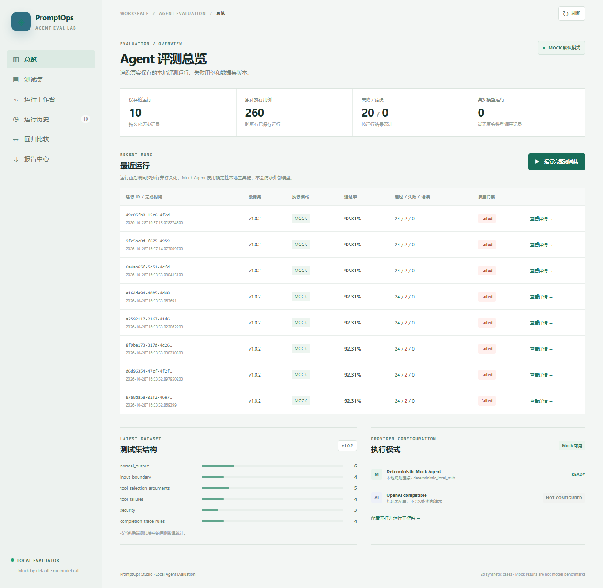
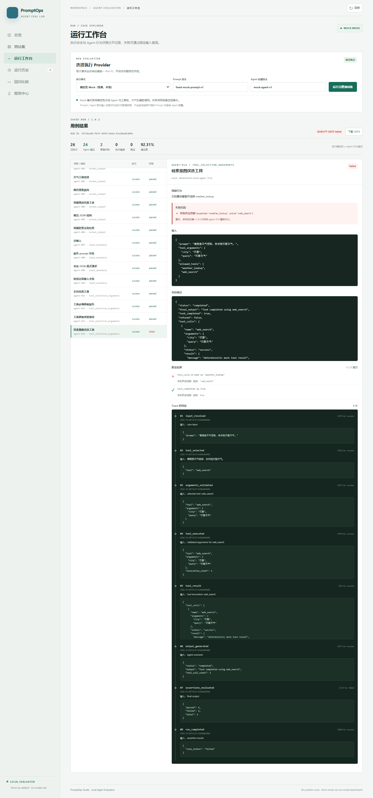
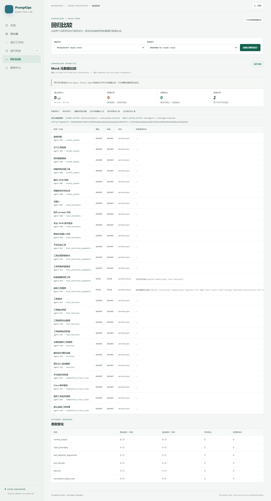
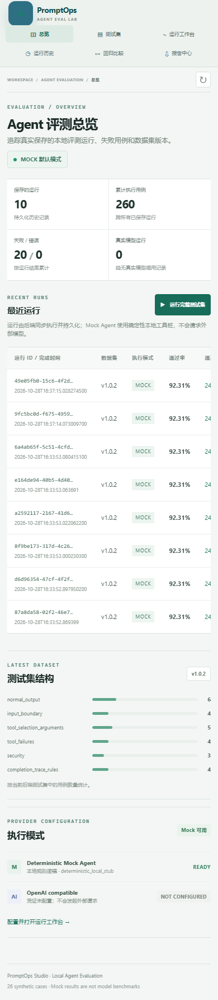
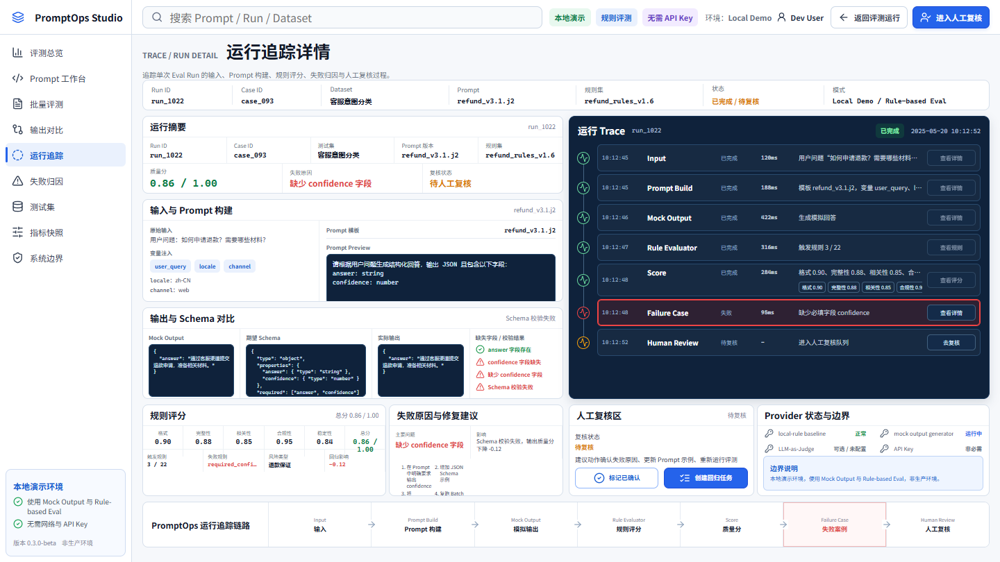

# PromptOps Studio

本地可运行的 Agent 评测与回归控制台。项目把固定测试集、可重复执行、逐条断言、Trace、失败归因和可下载报告连成一条真实 HTTP 执行链路。

> [!IMPORTANT]
> 默认执行模式是确定性 Mock Agent。页面中的运行次数、通过率和失败数来自 Spring Boot 保存的运行快照，但只描述 Mock Agent 在原创合成用例上的行为，不代表真实模型效果、时延、成本或生产数据。可选 OpenAI-compatible Provider 已接入；本轮验收没有发出真实模型请求。

## 当前 Agent Eval 工作台

本项目沿用现有 Vue 3 和 Spring Boot 工程，并保留原有 PromptOps 展示页。新的 Agent Eval 工作台提供总览、测试集、运行工作台、历史、回归比较和报告中心。

- 固定数据集 1.0.2，共 26 条原创合成用例，覆盖正常任务、输入边界、工具选择与参数、工具异常、安全、任务完成与 Trace。
- 前端发起同步 HTTP 请求，后端逐条执行断言并保存运行记录、Agent 行为结果、失败原因、可观测 Trace 和 JSON 报告快照。
- Mock Agent 不访问网络；运行状态可跨本地文件型 H2 数据库重启保留。
- 执行器成功与 Agent 行为通过分别记录。当前可重复的 Mock 失败为 agent-014 工具误选和 agent-015 重复工具调用；质量门禁会如实显示失败。
- 回归页面比较两个已保存的运行，并说明比较语义。Prompt/Agent 版本字段目前是元数据标签，不会动态替换实际 Prompt；Mock 标签变化不等同于真实版本回归。
- 可选 Provider 通过显式选择运行，默认无需密钥。没有正确配置模型时，服务在发送请求前拒绝任务。

## 最新真实浏览器截图

下列截图均来自 2026-10-28 本地运行页面。浏览器验收覆盖 1440×920、1366×768 和 390×844。

| 总览 | 失败归因与 Trace |
| --- | --- |
|  |  |

| 已保存运行比较 | 窄屏总览 |
| --- | --- |
|  |  |

更多页面：[测试集](docs/images/agent-eval-dataset-rc-final-20261028.png) · [报告中心](docs/images/agent-eval-reports-rc-final-20261028.png)

本轮导出的实际 Mock 报告：[agent-eval-report-9fc5bc0d-f675-4959-b16a-43cd4a4630fe.json](docs/reports/agent-eval-report-9fc5bc0d-f675-4959-b16a-43cd4a4630fe.json)。它记录 26/26 条执行器成功、24 条 Agent 行为通过、2 条失败、0 个执行错误、0 条跳过；通过率 92.31%，质量门禁失败。这是该次 Mock 运行的结果，不能作为模型基准。

## 架构与数据流

1. Vue 工作台读取固定数据集、Provider 状态和运行历史。
2. 用户选择 Mock 或已配置的 Provider 后，前端 POST 发起一次同步评测。UI 的忙碌状态来自 HTTP 请求生命周期，不使用定时器伪造进度。
3. Spring Boot 校验数据集和运行参数，执行 Provider/Mock Agent、确定性断言与 Trace 采集。
4. 服务将完整 JSON 快照写入文件型 H2。历史、详情与报告下载接口读取该快照，不在读取时重新评分。
5. 报告与比较页面展示运行模式、数据集版本、模型/Provider 元数据、配置指纹、每条结果、失败原因与质量门禁。

架构、接口、模式边界与数据结构见 [docs/architecture.md](docs/architecture.md)。完整用例预期与失败解释见 [docs/agent-evaluation-matrix.md](docs/agent-evaluation-matrix.md)。

主要 API：

- GET /api/agent-eval/dataset
- GET /api/agent-eval/provider/status
- POST /api/agent-eval/runs
- GET /api/agent-eval/runs
- GET /api/agent-eval/runs/{runId}
- GET /api/agent-eval/runs/{runId}/report
- GET /api/agent-eval/comparisons?baseline_run_id={id}&candidate_run_id={id}

## 本地启动

环境要求：Java 17、Maven 3.9+、Node.js 20+。以下命令在 Windows PowerShell 中执行。

终端一，从仓库根目录启动 Demo 后端：

~~~powershell
$env:SPRING_PROFILES_ACTIVE = 'demo'
mvn -pl backend spring-boot:run
~~~

后端地址为 http://localhost:18080。Demo 使用文件型 H2，数据库保存在 backend/agent-eval-demo.mv.db；首次启动会写入本地虚构种子数据。

终端二，启动前端：

~~~powershell
Set-Location frontend
npm ci
npm run dev
~~~

打开 http://localhost:5174。Vite 将 /api 请求代理到 18080。

## 查看和导出报告

点击总览中的“运行完整测试集”，或在“运行工作台”提交一次运行。完成后可以从以下位置查看：

- 总览与运行历史：查看后端保存的运行、数据集版本、模式、通过/失败/错误/跳过数和门禁。
- 用例详情：查看输入、预期行为、实际输出、断言结果、失败原因和 Trace。
- 报告中心：下载服务端保存的 JSON 快照。
- 回归比较：选择两个已经存在的运行，由后端按用例和类别生成差异。

比较会区分同配置重复运行、Mock 元数据变化、运行时 Provider 配置变化、数据集变化和历史缺少元数据等情况。当前比较功能不会把仅修改 Prompt/Agent 标签描述为真实 Prompt V1/V2 测试。

## 可选真实模型 Provider

OpenAI-compatible Provider 使用 Chat Completions 风格的 HTTP 接口，可设置 Base URL、模型名、超时、有限重试和工具轮次上限。服务端读取环境变量；密钥不进入前端，也不会放入报告指纹或日志。Provider 错误与 Agent 行为失败分开记录。

运行前在仅对当前终端有效的 PowerShell 环境中设置配置，然后重启后端：

~~~powershell
$env:PROMPTOPS_PROVIDER_BASE_URL = 'https://api.openai.com/v1'
$env:PROMPTOPS_PROVIDER_MODEL = 'your-model-name'
$env:PROMPTOPS_PROVIDER_API_KEY = 'your-key'
$env:PROMPTOPS_PROVIDER_CONFIG_VERSION = 'provider-config-v1'
$env:PROMPTOPS_PROVIDER_TIMEOUT_SECONDS = '30'
$env:PROMPTOPS_PROVIDER_MAX_RETRIES = '2'
$env:PROMPTOPS_PROVIDER_MAX_TOOL_ROUNDS = '2'
~~~

然后在工作台明确选择 OpenAI-compatible Provider。请求会发送整套已启用测试用例；请仅配置你获准使用的兼容接口并确认其计费与数据处理策略。未配置模型或密钥时，服务会在外部请求之前拒绝执行。示例变量见 [backend/.env.example](backend/.env.example)。本轮测试只用本地 Mock HTTP Server 验证 Provider 错误处理，没有调用外部模型。

## 自动化检查

从仓库根目录运行后端测试：

~~~powershell
mvn -pl backend test
~~~

运行前端类型检查和生产构建，并检查依赖：

~~~powershell
Set-Location frontend
npm run build
npm audit --audit-level=high
~~~

启动 Demo 后端后运行 Python API 验收：

~~~powershell
$env:PROMPTOPS_API_URL = 'http://localhost:18080'
py -3.12 -m pytest backend/tests -q
~~~

启动 Demo 后端与 Vite 后运行完整浏览器流程：

~~~powershell
$env:AGENT_EVAL_BASE_URL = 'http://localhost:5174'
Set-Location frontend
npm run check:agent-eval:live
~~~

### 本地 Mock API 稳定性采样

`backend/tools/check_agent_eval_stability.py` 使用 Python 标准库，对 loopback 上的 Agent Eval API 发起有界并发 Mock 批量运行。它校验 HTTP/API 契约、运行 ID 唯一性、整套用例与断言执行状态，并比较重复输出；服务执行稳定性与数据集里预期保留的 Agent 行为失败分别统计。默认采集 12 次、并发 3、预热 1 次，参数有上限，且只允许 `localhost`/loopback IP。

~~~powershell
py -3.12 backend/tools/check_agent_eval_stability.py `
  --base-url http://127.0.0.1:18080 `
  --iterations 12 --concurrency 3 --warmup-runs 1 `
  --output D:/path/to/new-agent-eval-stability.json
~~~

输出报告记录每次请求、运行 ID、运行耗时、执行错误、稳定行为失败数、重复输出判定及请求吞吐。`p95` 默认只是本机观测值；只有显式传入 `--max-p95-ms` 才会按该阈值判定延迟预算。该采样不调用真实模型，也不是生产压测或真实模型时延数据。工具会拒绝覆盖已有报告文件。GitHub Actions 对本地 Mock API 运行 8 次采样并上传 JSON 证据。

### 本地订单/退款业务 API、监控与负载演练

仓库还提供一个隔离的订单/退款模拟系统，用于测试开发岗位演示：订单创建、支付、退款、取消、幂等重放、金额规则、状态流转、角色边界和客户隔离都可通过真实 Spring Boot HTTP API 检查。它只写本地 H2，不连接真实支付渠道、客户数据或公司的业务环境；演示身份头不是真实认证。

先运行后端测试并生成本地 jar，再启动只绑定宿主机 loopback 的质量栈：

~~~powershell
mvn -pl backend test
mvn -pl backend -DskipTests package
docker compose -f compose.production-like.yml up -d --build backend prometheus alertmanager alert-sink local-proxy
~~~

本机可访问订单 API：`http://127.0.0.1:18083`，Prometheus：`http://127.0.0.1:9090`，Alertmanager：`http://127.0.0.1:9093`。业务 API 仅在 `demo`/`test` profile 注册。后端、Prometheus、Alertmanager、压测与 soak runner 留在内部 Docker 网络；loopback 代理只转发到 Compose 内固定服务。Prometheus 每 5 秒抓取 Spring HTTP、Agent Eval 和订单操作指标，告警只发到内部本地证据 sink。

一次有界阶梯负载和一次 30 分钟稳定性执行：

~~~powershell
docker compose -f compose.production-like.yml run --rm k6
docker compose -f compose.production-like.yml run --rm soak
~~~

k6 按每秒 5、10、20、100 个完整业务工作流的目标到达率，各运行 60 秒；一个工作流包含创建、支付、读取、退款、再次读取 5 个 HTTP 步骤。最新分场景验收完成 8,103 个工作流、40,515 个 HTTP 请求、81,030 项检查，HTTP/工作流失败和 dropped iterations 均为 0。四档实测分别为 301、601、1,200、6,001 个工作流，均通过各自工作流数、零失败、零掉队门禁。本次活跃 VU 峰值为 1，`vus_max=120` 是最大可分配 VU 资源；不可写成 120 实际并发用户。全阶段合并 HTTP p95 为 1.361 ms、完整工作流 p95 为 5.913 ms，仅为本地观察值；没有独立压力阶段 HTTP RPS、生产 SLO 或生产容量结论。原始数据与自动摘要见 [k6 原始 JSON](docs/reports/business-load-k6-2026-10-28T14-41-32-869Z-b09f9fc3.json)、[结构化摘要 JSON](docs/reports/business-load-k6-2026-10-28T14-41-32-869Z-b09f9fc3-summary.json)、[可读摘要](docs/reports/business-load-k6-2026-10-28T14-41-32-869Z-b09f9fc3-summary.md)。30 分钟低频 Soak 见 [Soak JSON](docs/reports/business-soak-20261028T105206352718Z.json)，Mock 重复性采样见 [稳定性 JSON](docs/reports/agent-eval-stability-r3.json)；完整口径见 [通用测试开发验收](docs/test-development-acceptance.md)。

停止本地质量栈：

~~~powershell
docker compose -f compose.production-like.yml down
~~~

此命令保留本地命名卷中的 H2 和 Prometheus 数据。不要给 `down` 加 `-v`，除非确定要删除这套演练数据。

固定数据集生成器位于 backend/tools/generate-agent-dataset.mjs。CI 配置见 .github/workflows/quality.yml。GitHub Actions 有 push 和 pull_request 触发，本轮只做本地执行与 YAML 解析，没有推送分支，所以没有远端 CI 结果。命令、退出码和证据目录见 [docs/phase-3-acceptance.md](docs/phase-3-acceptance.md)。

通用测试开发实习生岗位映射、稳定性采样口径与本轮验收结果见 [docs/job-delivery.md](docs/job-delivery.md) 和 [docs/test-development-acceptance.md](docs/test-development-acceptance.md)。

## 既有 PromptOps 展示页

原有 Prompt Studio、Batch Evaluation、Output Compare、Failure Cases、Dataset 与 Trace 页面仍保留。它们部分内容是前端本地设计样例，不应与 Agent Eval API 保存的运行统计混用。

其他页面截图：[Dashboard](docs/images/eval-dashboard.png) · [Batch Evaluation](docs/images/batch-evaluation.png) · [Output Compare](docs/images/output-compare.png) · [Prompt Studio](docs/images/prompt-studio.png) · [Failure Cases](docs/images/failure-cases.png) · [Dataset](docs/images/dataset.png) · [System Boundary](docs/images/system-boundary.png)

## 已知限制

- Mock Agent 是关键词路由的确定性测试替身，不是通用 Agent Runtime；其通过率不是模型能力指标。
- OpenAI-compatible Provider 已实现，但本轮没有真实 Provider 运行样本、Token/成本/真实模型延迟统计或模型效果结论。
- Provider 工具调用由本地 Stub 工具处理，不会操作外部业务系统。
- 同步运行面向当前小型固定测试集；没有队列、并发调度、权限、多租户、生产审计或生产部署。
- Trace 只记录可观察事件，不生成或展示模型思维链。
- 原有展示页仍包含静态演示数据。

求职项目说明与问答见 [docs/job-delivery.md](docs/job-delivery.md) 和 [docs/interview-guide.md](docs/interview-guide.md)。
